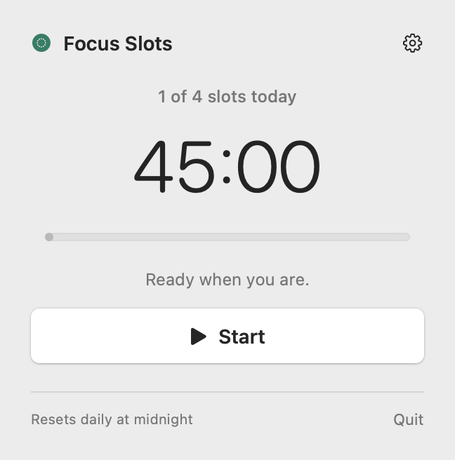
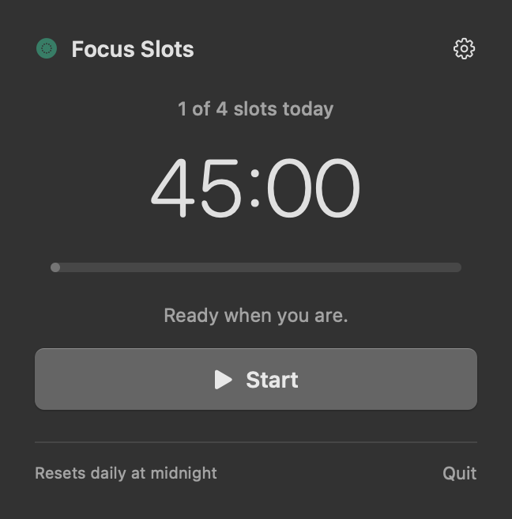
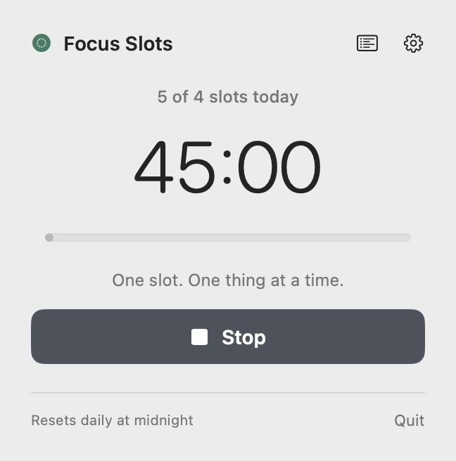
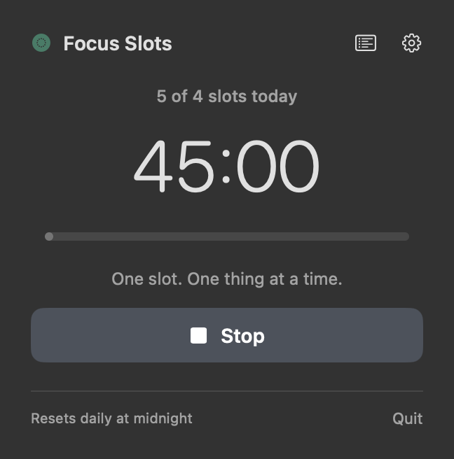
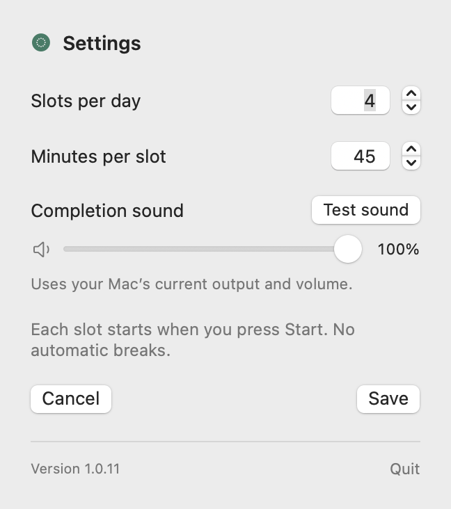
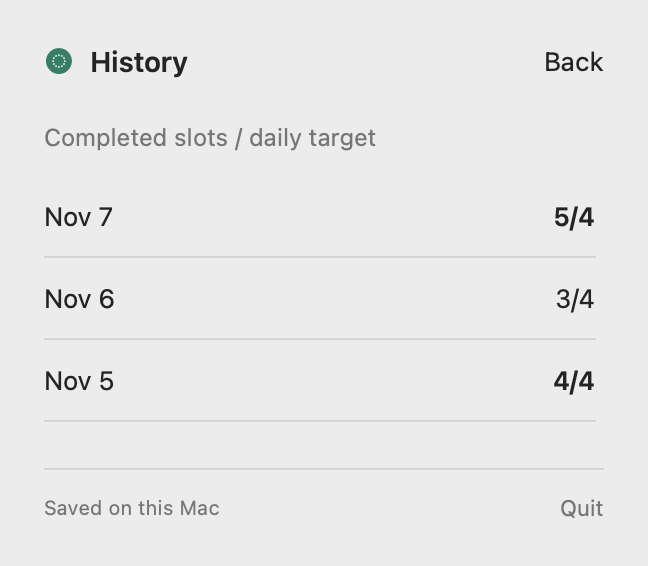

# Focus Slots

A simple native macOS menu bar app for manually started focus sessions. Set a daily goal and a slot length, start a timer, and hear a short chime when it finishes. No automatic breaks, accounts, or network access.

## Screenshots

| Light appearance | Dark appearance |
| --- | --- |
|  |  |

| Running timer — light | Running timer — dark |
| --- | --- |
|  |  |

Settings includes the daily target, slot length, sound preview and volume, and the running version.

| Settings | History |
| --- | --- |
|  |  |

## How it works

- The menu bar shows today's completed slots, such as **0/4**. While a slot runs, it also shows the remaining time.
- Click the count to open the timer. Press **Start** to begin and close the dropdown; the countdown stays visible in the menu bar. **Stop** discards an unfinished slot.
- A completed slot plays a gentle chime and increases the count. The timer returns to the full slot length, ready for another manual start. You can continue beyond the target, such as **5/4** after five completed slots.
- Defaults are **4 slots of 45 minutes**, with sound volume at **100%**. Settings lets you change these and preview the sound.
- The **History** icon, immediately left of Settings, opens a newest-first list such as **Nov 7 — 3/4**. Each date keeps its own daily target and includes extra slots.
- Settings, progress, and history persist across app restarts and app updates. The daily count resets at local midnight while its result remains in History.

A running timer includes time spent asleep or while the app is closed. An overdue timer completes on wake or relaunch. Slots that cross midnight count on their finish day; a slot that finished on a previous day is not added to today's count. Changing the slot length affects the next timer. You can continue beyond your daily target.

History begins with the saved day available when upgrading to 1.0.7 and continues from then on. Older versions discarded earlier daily totals, so those cannot be reconstructed. Only dates recorded by the app are listed; days skipped while the app is closed are not filled in.

## Requirements

- macOS 13 or newer to run the app.
- Apple's Command Line Tools and Swift 6 or newer to build. No third-party packages or paid Apple developer account are needed for a local build.
- Builds and native tests have been verified with Swift 6.0.3 and the macOS 15.2 SDK on macOS 15. The SDK fallback and installer failure cases also have isolated script tests. The macOS 27 Command Line Tools environment reported in [issue #1](https://github.com/ruslansavenok/focus-slots/issues/1) is not available on this development Mac.

Install the Command Line Tools if needed:

```bash
xcode-select --install
```

## Install or update from source

Clone the project into a new folder:

```bash
mkdir -p ~/Projects
cd ~/Projects
git clone https://github.com/ruslansavenok/focus-slots.git FocusSlots
cd FocusSlots
bash install.sh
```

The script builds and verifies the app for your Mac's architecture, stops your running Focus Slots copy, replaces **~/Applications/Focus Slots.app**, and opens the new copy. It stages and verifies the replacement before stopping the old app and restores the previous copy if replacing it fails. It does not require administrator access. There is no PKG or DMG packaging.

For later updates, run from the project folder:

```bash
git pull --ff-only
bash install.sh
```

Look for your saved count in the menu bar; there is no Dock icon. Open Settings to confirm **Version 1.0.11**, and use **Test sound** to check the chime. If you have a copy in `/Applications` or under the former **Time Slots** name, quit it before updating and remove that old app bundle afterward to avoid launching an outdated copy. Removing the app bundle does not remove your saved settings or history.

The default install folder is `~/Applications`. To choose a different folder, including `/Applications` on a Mac where you have write permission and policy allows it:

```bash
INSTALL_DIR=/Applications bash install.sh
```

Paths with spaces are supported. Avoid using `sudo`; use a folder your account can write to. To uninstall, quit the app and move **Focus Slots.app** from your chosen Applications folder to Trash.

An update preserves saved progress, a running timer, settings, and history through the original bundle identity and preference keys. Version 1.0.4 set completion sound volume to 100% once on first launch, including upgrades. Later volume adjustments are saved normally. Sound follows your Mac's selected output, volume, and mute setting.

### Managed Macs and signing

The app is built locally with an ad-hoc signature; Developer ID signing and Apple notarization are not configured. The reporter in issue #1 could run the app from `~/Applications`, while copies in `/Applications` were killed by their managed Mac. The default install location follows that working setup. Other organisations may enforce different policies: the script does not bypass Gatekeeper or endpoint security. If a locally built app is blocked, ask your administrator about an approved location or signing requirement. A successful `open` command submits a launch request; it cannot guarantee endpoint software will allow the app to keep running.

## Build without installing

```bash
bash build.sh
open "build/Focus Slots.app"
```

The build tests timer logic, generates the icon and sound, compiles only the host architecture (`arm64` or `x86_64`), and verifies the executable architecture, bundle metadata, and ad-hoc signature. The app is **build/Focus Slots.app**. Build files are generated locally and excluded from Git. Quit any already-running copy before opening a different build.

To build both Intel and Apple Silicon slices explicitly:

```bash
bash build.sh --universal
# Or build both slices, install, and launch:
bash install.sh --universal
```

Universal builds depend on the selected Apple toolchain supporting both architectures. Some Apple Silicon Command Line Tools releases lack Intel compatibility libraries and can emit linker warnings for the Intel slice; native builds avoid that cross-architecture dependency. Each architecture is verified with a separate `lipo -verify_arch` call for compatibility with newer tools.

### SDK selection with Command Line Tools

The build first typechecks a small SwiftUI `@State` view against the default macOS SDK. If that fails, it tries other SDKs installed alongside it, newest first, and uses the newest compatible one. This handles the macOS 27 SDK requiring a `SwiftUIMacros` compiler plugin that some Command Line Tools installations do not include, when a compatible older SDK is also installed.

To select an installed SDK explicitly, set `SDKROOT` to its full path:

```bash
SDKROOT=/Library/Developer/CommandLineTools/SDKs/MacOSX26.5.sdk bash install.sh
# The same override is supported by build.sh and test-ui.sh.
```

An explicit override is checked and is never silently replaced. If no installed SDK passes the check, the build prints the compiler diagnostic and stops before changing an installed app. Install/select a compatible SDK or full Xcode with the required plugin. The selected SDK is printed on each build; probe diagnostics are saved in `build/`.

## Tests and screenshot generation

After building, run the native integration checks in your Mac's logged-in desktop session:

```bash
bash test-ui.sh
bash Tests/ScriptTests.sh
```

These checks exercise saved settings and progress, start/stop, live completion, real audio playback, sound preview, and volume persistence. The suite uses isolated preferences, briefly plays the chime twice, and renders Start and Stop in light and dark mode, plus Settings and History screenshots into `build/`.

The script tests simulate missing/present SwiftUI macro plugins, SDK selection and explicit overrides. They use a disposable app copy and mocked process/launch commands to check installation, replacement, rollback, and failure handling without stopping or launching your app. Run them after `build.sh`; the scripts support macOS's built-in Bash 3.2.

The README screenshots live separately in `screenshots/`. Refresh them after reviewing the rendered images:

```bash
cp build/popover-light.png screenshots/timer-light.png
cp build/popover-dark.png screenshots/timer-dark.png
cp build/popover-running-light.png screenshots/running-light.png
cp build/popover-running-dark.png screenshots/running-dark.png
cp build/popover-settings.png screenshots/settings.png
cp build/popover-history.png screenshots/history.png
```

## Project layout

| Path | Purpose |
| --- | --- |
| `Sources/` | Timer state, audio playback, menu bar app, and Settings UI |
| `Resources/make-assets.swift` | Generates the icon and completion chime locally |
| `Tests/` | Timer behavior, build/install script checks, and native integration checks |
| `screenshots/` | Screenshots displayed in this README |
| `build.sh` | Builds, signs, and verifies the native app; optional universal build |
| `install.sh` | Builds, replaces the app in `~/Applications` by default, and opens it |
| `test-ui.sh` | Runs native checks and renders screenshots |
| `Tests/ScriptTests.sh` | Checks SDK compatibility handling and installation in isolated fixtures |
| `version.sh` | Defines the release version and internal build number |
| `toolchain.sh` | Probes SDK compatibility and configures the compiler cache |

Some Command Line Tools installations contain duplicate SwiftBridging headers. The build handles this with a project-local virtual filesystem overlay, without changing the installed Apple tools.
